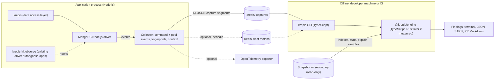

# Architecture

> Draft. Component names and boundaries are proposals. Built today: `krepis` (the data layer and `@sameernair/krepis/connections`) and `krepis-kit` (`observe`, the collector, and the `analyze`, `init` and `drill` commands). The separate engine package, the other CLI commands, OpenTelemetry export, fleet aggregation and the proxy are planned, not built.

## Overview

Krepis has a **thin runtime** that lives inside the application and a **heavy analysis engine** that runs offline (on a developer machine or in CI). They communicate through capture files, never through the application's hot path.



## Components

| Component | Language | Runs where | Responsibility |
|---|---|---|---|
| `krepis` (DAL) | TypeScript | App | Typed collections, schema, queries, relations, pipelines, transactions, safe defaults. Built on the official driver. |
| `krepis-kit` (`observe`) | TypeScript | App | Attaches the collector to an existing `MongoClient` (and therefore Mongoose). No API changes for the app. |
| Collector | TypeScript | App | Listens to driver command monitoring and connection-pool (CMAP) events; fingerprints queries; attaches request context and sampled call sites; writes capture segments. |
| `@krepis/engine` | TypeScript (Rust via napi-rs later, if measured) | Offline | Statistics (shapes, presence, sketches), implicit-reference detection, rule evaluation, explanation generation. |
| `krepis-kit` CLI (bins `krepis-kit`, `krepis`) | TypeScript | Offline | Commands (`analyze`, `refs`, `infer`, `ci`, `connections`, `indexes plan`); reads captures; calls the engine; renders reports. |
| `@krepis/otel` | TypeScript | App | Optional. Exports fingerprints and findings as OpenTelemetry spans and attributes. |
| `@krepis/fleet-redis` | TypeScript | App + CLI | Optional. Aggregates pool metrics across instances, off the query path. |
| `krepis-proxy` | Rust | Sidecar | **Deferred.** Connection multiplexing proxy, built only if measurements require it (see [Connections](CONNECTIONS.md)). |

## Why TypeScript at runtime, and Rust offline only when measured

- **The collector runs on every query.** Crossing from JavaScript into native code per event means serialising the event each time, which can cost more than the work itself. The collector's work (fingerprinting, buffering) is cheap, so it stays in JavaScript.
- **The engine starts in TypeScript.** Phase 0 captures are small and analysis is offline, so speed is not yet a constraint, while a native build matrix is a large fixed cost. The engine keeps a narrow interface (captures and metadata in, findings out) so it can move to Rust when profiling on real captures shows sampling, presence statistics or reference containment checks are CPU-bound.
- **Reuse across languages** (Python via PyO3, Go, Java) is the later argument for a Rust engine. It does not justify the cost before the findings are validated.

## What the client can and cannot see

- **Documents examined are not in driver events.** Command-succeeded events carry the reply, which has documents returned but not keys or documents examined. Those come from `explain`, the server profiler or slow-query logs. The collector records what the reply provides; the analyzer adds plan evidence separately.
- **Snapshot `explain` is evidence, not ground truth.** A plan chosen on a snapshot or secondary can differ from production because of data distribution, index sets or plan-cache state. Findings based on `explain` say where the plan came from, and rules prefer evidence that doesn't depend on it (frequency, duration, N+1 per request).
- **Monitoring sockets emit no command events.** Connection counts per node are computed from topology (clients × servers × monitoring sockets) plus pool events, not counted from events alone.

## Data flow

1. **Capture (runtime).** For each command the collector records: collection, operation, fingerprint, duration, documents returned and examined (where available), context ID, and, sampled, the call site. Pool events record created, checked out, checked in, closed (with reason), cleared and checkout-failed, with wait times.
2. **Persist.** Events are buffered in memory and flushed as rotated NDJSON segments to `.krepis/` (configurable). A fingerprint dictionary maps fingerprint hashes to normalised shapes, so segments stay small.
3. **Analyse (offline).** The CLI loads captures, connects read-only to a snapshot or secondary for metadata (`listIndexes`, `$indexStats`, `collStats`, `explain` with `queryPlanner` verbosity, sampled documents), and hands both to the engine.
4. **Report.** The engine returns findings. The CLI renders them for a terminal, as JSON, as SARIF (for code-scanning integrations) or as Markdown for pull-request comments.

## Query fingerprinting

A fingerprint identifies a query **shape** independent of its values.

- **Filters:** keys sorted; operators kept (`$gt`, `$in`, `$exists`, ...); values replaced by type tokens (`<string>`, `<objectId>`, `<number>`, ...); arrays become `[<type>]`; `$in` list lengths bucketed (1, 2–10, 11–100, 100+).
- **Options:** sort keys and directions, projection keys, presence of `limit` and `skip` (not their values), hint.
- **Pipelines:** stage sequence with each stage normalised the same way; `$lookup` records `from`, `localField` and `foreignField`.
- **Hash:** a stable 64-bit hash of the canonical form; the canonical form is stored once in the dictionary.

The same normalisation powers the **operator-injection signal**: a call site that normally sends `{ email: <string> }` and suddenly sends `{ email: { $ne: <null> } }` changes fingerprint at a fixed location.

## Context and call sites

- **Context:** `AsyncLocalStorage` carries a context ID per HTTP request, job or test case. Integrations set it automatically (implemented: Express/Connect middleware, Apollo Server plugin; planned: Fastify, NestJS); otherwise `observer.run(label, fn)`, or `observer.begin(label)` → `enter()` / `end()` for hooks that cannot wrap a callback. Each context records the context that was current when it began; once it ends, code still running in it is attributed to that parent, so an `enterWith` that reaches further than intended cannot lose commands. N+1 detection depends on this grouping.
- **Call sites:** capturing a stack trace is the costliest per-command step (measured ~50–60 µs of client CPU), so it is done at most three times per fingerprint per context (a loop of 100 identical lookups costs three captures, not 100; three, not one, so that repeats from several code paths show as several sites), and lazily: `Error.captureStackTrace` records the frames, and they are formatted and parsed only for commands that end up in a finding. Formatting was most of the cost (a short GraphQL operation went from +18–23% client CPU to +4%). `Error.stackTraceLimit` is raised temporarily during capture, because the default of 10 frames is used up by driver internals before the application frame is reached. Frames inside `node:` internals, `node_modules` and Krepis itself are skipped. A function that returns a query promise without `await` drops its own frame (a V8 property), so the reported site is the nearest awaiting caller. A call site is a chain of up to three application frames, one per file hop (`sorted.js:274 ← user/online.js:26 ← middleware/index.js:79`): the nearest frame alone names the data layer, never the loop that calls it.

## Failure isolation

- The collector is **designed never to throw** into application code. Event listeners run inside the driver's `emit`, which is inside the application's query, so every handler (and the user's `onFinding` callback) is wrapped; internal errors are counted (`observer.internalErrors`), not raised. Tested by breaking the handlers deliberately and checking the query still succeeds.
- The in-memory buffer is **bounded**. Under backpressure, events are dropped (and the drop count recorded), never queued without limit.
- **Kill switch:** `KREPIS_DISABLED=1` disables collection at startup without code changes: no listeners, and `monitorCommands` is left off.
- **Overhead budget:** the collector must add no more than a small, measured amount of latency. `bench/overhead.ts` measures it.
- **Context-gated monitoring:** commands are recorded only inside a Krepis context, never client-wide. Outside a context the driver runs untouched apart from one context lookup per command. Inside, on promise-style drivers (mongodb 6.x and later), monitoring stays off: the observer records the command from its arguments and the reply `Connection.command` returns, and retained documents are decoded only if a rule reads them. Callback-style drivers keep per-command monitoring, and pay the driver's event cost (a second deserialization of cursor replies) inside a context. `gateMonitoring: false` forces the old client-wide mode, which is also the automatic fallback. Drivers whose `Connection.command` takes a callback (mongodb 4.x, 5.x, 6.0) are gated through the callback; the optimisations below are not applied to them.
- **Production default:** collection is off in production unless enabled explicitly, and is sampled per unit of work (`sampleRate`): unsampled requests get no context and so pay essentially nothing.
- **Optimisations (opt-in, `optimize`):** the same gated hook can answer an N+1 `_id` loop from one `$in` prefetch and a repeated identical read from its earlier reply, with `verify` sampling optimised answers against the server and classifying any difference, and a content-based freshness gate retiring held answers that a newer reply in the request contradicts. It sits in `Connection.command`, below every library, so it covers the raw driver and Mongoose alike. Every internal error falls back to the application's original command, and anything outside a narrow allowlist passes through untouched.

## Engine design

- **Inputs:** capture segments, fingerprint dictionary, database metadata, and document samples (statistics only are kept).
- **Statistics:** per-collection shape and presence statistics (presence dependence between fields), type conflicts, value sketches for skew (HyperLogLog, count-min, t-digest), all with recorded sample support.
- **Rules:** each rule implements one interface: required inputs, `detect` (produces evidence), `explain` (produces text from evidence), `fix` (produces an artifact: an index definition, a code suggestion, a configuration value). See [Rules](RULES.md).
- **Determinism:** the same inputs produce the same findings, in the same order. Sampling uses fixed seeds recorded in the report.

## Capture format

- NDJSON, with a versioned header line per segment (`{"krepis_capture": 1, "krepis": <version>, "node", "pid", "startedAt"}`). Files are `krepis-<timestamp>-<pid>-<n>.ndjson`.
- Then three line types:
  - `{"t":"shape","fp","ns","op","shape"}`: the dictionary, once per fingerprint per segment, so every segment is readable on its own.
  - `{"t":"ctx","at","label","ms","cmds":[[fp, count, served, failed, sumMs, maxMs, returned]]}`: one per unit of work, its commands aggregated by fingerprint.
  - `{"t":"finding","at",...}`: findings computed in process, written finished.
- Written off the request path: a unit of work's lines are buffered when it ends and appended synchronously once a second by an unref'd timer, and on `detach()` and process exit. The buffer is bounded (overflow drops whole units of work, counted); write failures are counted, never thrown.
- Segments rotate by size (default 16 MB). When a segment opens, `krepis-*.ndjson` files in the directory older than the retention setting (default 7 days) are deleted; other files are never touched.
- Pool events are not captured yet (Phase 0, with the connection rules).
- The format is documented and stable within a major version, so captures from one version can be analysed by later minor versions.

## Packaging

- Phase 0 to 2: all packages are plain TypeScript, with no native dependency anywhere.
- If the engine moves to Rust, `@krepis/engine` ships prebuilt binaries per platform as optional dependencies (Linux glibc and musl, x64 and arm64; macOS x64 and arm64; Windows x64), built in a CI matrix, with a **WASM fallback** for unsupported platforms.
- The runtime packages (`krepis`, `krepis-kit`) have **no native dependency**, so installing Krepis in an app never requires a native build.
- Published with npm provenance.

## Monorepo layout

```
krepis/
├── packages/
│   ├── krepis/           # data layer + connections (npm: krepis)
│   ├── kit/              # analyser, observe, CLI, drills (npm: krepis-kit)
│   ├── engine/           # analysis engine, TypeScript (npm: @krepis/engine)
│   ├── otel/             # npm: @krepis/otel
│   └── fleet-redis/      # npm: @krepis/fleet-redis
├── crates/               # later, only if profiling shows the engine is CPU-bound
│   ├── krepis-engine/    # Rust port of the engine
│   ├── krepis-node/      # napi-rs bindings
│   └── krepis-proxy/     # deferred
├── fixtures/             # known-answer datasets and recorded captures
└── docs/
```
