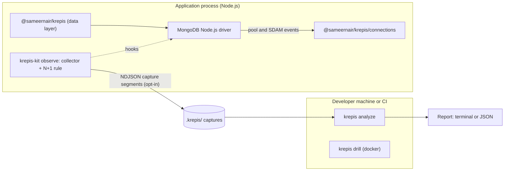

# Architecture

How the two packages fit together, and how the analyser records and reports.

## Overview

Everything runs inside your application or on your machine and CI. Observe mode finds N+1 patterns in process as each unit of work ends; capture files let `krepis analyze` group them across many requests later. Nothing is sent anywhere.



## Components

| Component | Runs where | Responsibility |
|---|---|---|
| `@sameernair/krepis` | App | Typed collections, schema, queries, relations, pipelines, transactions, safe defaults. Built on the official driver. |
| `@sameernair/krepis/connections` | App | `checkConnectionOptions`, `watchConnections`, `TenantPools`, `IncidentMonitor` and the flight recorder. Uses pool and SDAM events only. See [Connections](CONNECTIONS.md). |
| `observe` (`@sameernair/krepis-kit`) | App | Attaches the collector to an existing `MongoClient` (and therefore Mongoose). No changes to your data code. |
| Collector | App | Records commands inside a unit of work; fingerprints them; samples call sites; runs the N+1 rule when the unit ends; optionally writes capture segments. |
| `krepis` CLI (bins `krepis`, `krepis-kit`) | Machine or CI | `analyze` reads captures and groups findings across units of work; `init` sets up `.krepis/`; `drill` runs connection drills. |
| Drill (`@sameernair/krepis-kit/drill`) | Machine or CI | Runs your connection code against a disposable MongoDB in docker while injecting faults. |

## What the client can and cannot see

- **Documents examined are not in driver events.** A command's reply has documents returned, but not keys or documents examined; those come from `explain`, the server profiler or slow-query logs. The collector records what the reply provides.
- **Monitoring sockets emit no command events.** Connection counts per node are computed from topology (clients × servers × monitoring sockets) plus pool events, not counted from events alone.

## Data flow

1. **Record.** Inside a unit of work, the collector records each command: namespace, operation, fingerprint, timing, documents returned, and, for up to three commands per shape per unit, a call site.
2. **Detect.** When the unit ends, the N+1 rule runs over its commands. Findings go to `onFinding`. KR-S001 and KR-S002 (and, with `explain` or `hazards` on, the other plan and hazard rules) inspect each new query shape as it is seen, and report through `onPlanFinding` and `onHazard`.
3. **Persist (opt-in).** With `capture` on, the unit's commands are aggregated by fingerprint and written, with its findings, to rotated NDJSON segments in `.krepis/`.
4. **Report.** `krepis analyze` reads the segments, groups the same pattern across units of work, and prints a report: text, JSON, Markdown or SARIF, optionally compared with a baseline. It does not connect to the database.

## Query fingerprinting

A fingerprint identifies a query **shape** independent of its values.

- **Filters:** keys sorted; operators kept (`$gt`, `$in`, `$exists`, ...); values replaced by type tokens (`<string>`, `<objectId>`, `<number>`, ...); arrays become the set of their element types, so `$in` of 3 ids and of 300 ids is the same shape.
- **Options:** sort and projection specs; `limit` and `skip` as size buckets, not exact values.
- **Pipelines:** stage sequence with each stage normalised the same way; `$lookup` records `from`, `localField`, `foreignField` and its sub-pipeline.
- **Hash:** the first 64 bits of a SHA-1 of the canonical form; the canonical form is stored once per segment.

## Context and call sites

- **Context:** `AsyncLocalStorage` carries a context ID per HTTP request, job or test case. Integrations set it automatically (Express/Connect middleware, Apollo Server plugin); otherwise `observer.run(label, fn)`, or `observer.begin(label)` → `enter()` / `end()` for hooks that cannot wrap a callback. Each context records the context that was current when it began; once it ends, code still running in it is attributed to that parent, so an `enterWith` that reaches further than intended cannot lose commands. N+1 detection depends on this grouping.
- **Call sites:** capturing a stack trace is the costliest per-command step (measured ~50–60 µs of client CPU), so it is done at most three times per fingerprint per context (a loop of 100 identical lookups costs three captures, not 100; three, not one, so that repeats from several code paths show as several sites), and lazily: `Error.captureStackTrace` records the frames, and they are formatted and parsed only for commands that end up in a finding. Formatting was most of the cost (a short GraphQL operation went from +18–23% client CPU to +4%). `Error.stackTraceLimit` is raised temporarily during capture, because the default of 10 frames is used up by driver internals before the application frame is reached. Frames inside `node:` internals, `node_modules` and Krepis itself are skipped. A function that returns a query promise without `await` drops its own frame (a V8 property), so the reported site is the nearest awaiting caller. A call site is a chain of up to three application frames, one per file hop (`sorted.js:274 ← user/online.js:26 ← middleware/index.js:79`): the nearest frame alone names the data layer, never the loop that calls it.

## Failure isolation

- The collector is **designed never to throw** into application code. Event listeners run inside the driver's `emit`, which is inside the application's query, so every handler (and the user's `onFinding` callback) is wrapped; internal errors are counted (`observer.internalErrors`), not raised. Tested by breaking the handlers deliberately and checking the query still succeeds.
- The in-memory buffer is **bounded**. Under backpressure, events are dropped (and the drop count recorded), never queued without limit.
- **Kill switch:** `KREPIS_DISABLED=1` disables collection at startup without code changes: no listeners, and `monitorCommands` is left off.
- **Overhead budget:** the collector must add no more than a small, measured amount of latency. `bench/overhead.ts` measures it.
- **Context-gated monitoring:** by default, commands are recorded only inside a Krepis context. Outside a context the driver runs untouched apart from one context lookup per command. Inside, on promise-style drivers (mongodb 6.x and later), monitoring stays off: the observer records the command from its arguments and the reply `Connection.command` returns, and retained documents are decoded only if a rule reads them. Callback-style drivers keep per-command monitoring, and pay the driver's event cost (a second deserialization of cursor replies) inside a context. `gateMonitoring: false` forces client-wide monitoring, which is also the automatic fallback when the driver internals are not found. Drivers whose `Connection.command` takes a callback (mongodb 4.x, 5.x, 6.0) are gated through the callback; the optimisations below are not applied to them.
- **In production:** nothing is recorded outside a unit of work, capture to disk is off unless enabled, and `sampleRate` samples per unit of work: unsampled requests get no context and so pay essentially nothing.
- **Optimisations (opt-in, `optimize`):** the same gated hook can answer an N+1 `_id` loop from one `$in` prefetch and a repeated identical read from its earlier reply, with `verify` sampling optimised answers against the server and classifying any difference, and a content-based freshness gate retiring held answers that a newer reply in the request contradicts. It sits in `Connection.command`, below every library, so it covers the raw driver and Mongoose alike. Every internal error falls back to the application's original command, and anything outside a narrow allowlist passes through untouched.

## Capture format

- NDJSON, with a versioned header line per segment (`{"krepis_capture": 1, "krepis": <version>, "node", "pid", "startedAt"}`). Files are `krepis-<timestamp>-<pid>-<n>.ndjson`.
- Then three line types:
  - `{"t":"shape","fp","ns","op","shape"}`: the dictionary, once per fingerprint per segment, so every segment is readable on its own.
  - `{"t":"ctx","at","label","ms","cmds":[[fp, count, served, failed, sumMs, maxMs, returned]]}`: one per unit of work, its commands aggregated by fingerprint.
  - `{"t":"finding","at",...}`: findings computed in process, written finished. Plan and hazard findings are written on their own line as they are found, not with a unit of work.
- Written off the request path: a unit of work's lines are buffered when it ends and appended synchronously once a second by an unref'd timer, and on `detach()` and process exit. The buffer is bounded (overflow drops whole units of work, counted); write failures are counted, never thrown.
- Segments rotate by size (default 16 MB). When a segment opens, `krepis-*.ndjson` files in the directory older than the retention setting (default 7 days) are deleted; other files are never touched.
- Pool events are not captured; connection behaviour is covered by `@sameernair/krepis/connections`.
- The format is documented and stable within a major version, so captures from one version can be analysed by later minor versions.

## Packaging

- Plain TypeScript compiled to JavaScript, with no native dependency anywhere, so installing Krepis never requires a native build.
- Published from CI with npm trusted publishing and provenance.

## Monorepo layout

```
krepis/
├── packages/
│   ├── krepis/           # data layer + connections (npm: @sameernair/krepis)
│   └── kit/              # analyser, observe, CLI, drills (npm: @sameernair/krepis-kit)
├── docs/                 # this site (VitePress)
└── scripts/              # build and packaging helpers
```
